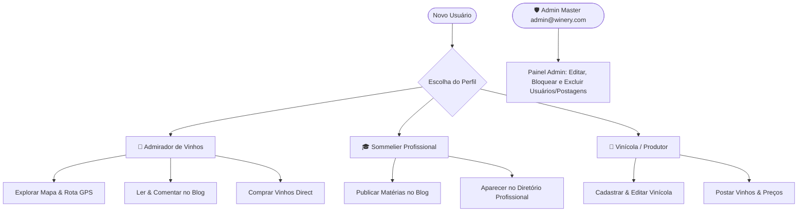

# 🍇 Winery Finder — Documentação Completa do Projeto


O **Winery Finder** é uma plataforma desenvolvida em Flutter projetada para conectar apreciadores de vinho a vinícolas do Brasil e do mundo. O aplicativo conta com mapa interativo livre, navegação por trajeto real pelas ruas, direcionamento GPS no Google Maps, catálogo de vendas de vinhos, diretório de sommeliers profissionais, blog coletivo de harmonização e controle de permissões por perfil.

---

## 📋 Sumário
1. [Visão Geral e Perfis de Usuário](#-visão-geral-e-perfis-de-usuário)
2. [Fluxograma de Funcionamento do Sistema](#-fluxograma-de-funcionamento-do-sistema)
3. [Arquitetura e Módulos de Software](#-arquitetura-e-módulos-de-software)
4. [📱 Detalhamento das Telas e Funcionalidades](#-detalhamento-das-telas-e-funcionalidades)
5. [📖 Tutorial Passo a Passo do Usuário](#-tutorial-passo-a-passo-do-usuário)
6. [📊 Modelagem de Dados (Domain)](#-modelagem-de-dados-domain)
7. [🧪 Qualidade e Testes Automatizados](#-qualidade-e-testes-automatizados)
8. [🚀 Como Executar e Subir para o GitHub](#-como-executar-e-subir-para-o-github)

---

## 🎯 Visão Geral e Perfis de Usuário

O sistema contempla **3 Perfis Principais de Usuário** e o **Administrador Master**:



---

## 📱 Detalhamento das Telas e Funcionalidades

### 1. Tela de Login (`LoginScreen`)
- **Visual**: Fundo com foto de videira (`VineyardBackground`) e logotipo realista de cacho de uvas roxas (`WineryLogo`).
- **Recursos**: Login seguro com e-mail e senha, botão para mostrar/ocultar senha e atalho para o cadastro.

### 2. Tela de Cadastro de Usuário (`RegisterScreen`)
- **Escolha do Perfil**: Select para definir o papel do usuário:
  - **Admirador de Vinhos**: Perfil de consumidor.
  - **Sommelier Profissional**: Abre os campos exclusivos de **Formação Profissional / Certificações** (ex: *WSET Level 3, ABS, FISAR*), **Histórico Profissional** e **Contatos**.
  - **Vinícola / Produtor**: Perfil de proprietário para cadastrar estabelecimentos e vinhos.
- **Foto Pessoal**: Upload de foto do computador ou galeria.

### 3. Tela Principal & Mapa Interativo Livre (`MapScreen`)
- **Layout Dividido Inteligente**: O mapa fica no topo em `Expanded(flex: 3)`, totalmente livre e **nunca é coberto** por popups. Os detalhes e a lista aparecem na parte inferior (`Expanded(flex: 2)`).
- **Trajeto Real do Seu Endereço**: Geocodifica o endereço cadastrado no perfil do usuário e calcula o caminho real pelas ruas e rodovias (via *OSRM Routing / OpenStreetMap*).
- **Destaque Visual da Rota**: Desenha a rota no mapa em camada dupla: **borda em amarelo/dourado neon com linha interna cor vinho**.
- **Botão Seguir Rota com GPS no Google Maps**: Abre o **Google Maps** em modo de navegação por voz curva a curva a partir do endereço do usuário.

### 4. Blog Coletivo de Sommeliers (`BlogScreen`)
- **Conteúdo**: Artigos de degustação e harmonização criados por Sommeliers.
- **Interação**: Espaço de comentários aberto para Admiradores, Vinícolas e Sommeliers.
- **Controle do Admin**: Apenas o usuário `admin@winery.com` tem o botão exclusivo para excluir matérias ou comentários.

### 5. Diretório de Sommeliers Profissionais (`SommeliersScreen`)
- **Perfil Completo**: Lista os Sommeliers com foto, certificações (ex: *WSET*), histórico profissional e dados de contato.

### 6. Painel de Gestão de Produtos e Vinícolas (`WineryProductsPanel` & `EditWineryDialog`)
- **Edição pelo Criador**: Cada vinícola pode ser editada ou excluída diretamente pelo usuário que a cadastrou (ou pelo admin).
- **Postagem de Vinhos**: Postagem de bebidas com preço em R\$, uva utilizada, foto do rótulo e **Link de Pagamento Direct** (*MercadoPago, WhatsApp, Loja Online*).

### 7. Painel do Administrador Master (`AdminDashboardScreen`)
- **Exclusivo para `admin@winery.com`**:
  - **Alterar Cadastro**: Editar qualquer dado de usuários.
  - **Bloquear / Desbloquear**: Impedir login de contas bloqueadas.
  - **Excluir Cadastro**: Remover usuários e contribuições do sistema.

---

## 📖 Tutorial Passo a Passo do Usuário

### Passo 1: Criando uma Conta por Perfil
1. Na tela de Login, clique em **"Não tem uma conta? Cadastre-se"**.
2. Escolha seu perfil (**Admirador**, **Sommelier** ou **Vinícola**).
3. Caso selecione **Sommelier**, preencha suas certificações e histórico.
4. Adicione sua foto e clique em **"Cadastrar Conta"**.

### Passo 2: Traçando Rota do Seu Endereço no Mapa
1. Na tela do Mapa, selecione qualquer vinícola e clique em **"Trajeto Real no Mapa"**.
2. O aplicativo geolocalizará o seu endereço cadastrado e desenhará o caminho destacado pelas ruas.
3. Clique em **"Seguir Rota com GPS no Google Maps"** para abrir a navegação por voz no celular.

### Passo 3: Cadastrando e Gerenciando Vinícolas e Vinhos
1. Clique no botão **"+ Cadastrar Vinícola"**.
2. Selecione o **Logo da Vinícola (em 1º lugar)** e digite o **Nome do Proprietário (em 2º lugar)**.
3. Após salvar, abra a ficha da sua vinícola e clique em **"Painel de Produtos"** para cadastrar vinhos, fotos e links de pagamento.

---

## 📊 Modelagem de Dados (Domain)

```dart
// Perfil de Usuário
enum UserRole { admirer, sommelier, winery, admin }

class UserAccount {
  final String id;
  final String name;
  final String email;
  final UserRole role;
  final String photoUrl;
  final String cpf;
  final String phone;
  final String address;
  final bool isBlocked;
  final String professionalHistory;
  final String education;
  final String contactInfo;
}

// Vinícola
class Winery {
  final String id;
  final String name;
  final String city;
  final Set<WineType> wineTypes;
  final double distanceKm;
  final double rating;
  final double latitude;
  final double longitude;
  final String address;
  final String logoUrl;
  final List<String> photoUrls;
  final String responsibleName;
  final String sommelierName;
  final List<String> cultivatedGrapes;
  final String creatorEmail;
}

// Vinho / Produto
class WineProduct {
  final String id;
  final String wineryId;
  final String name;
  final WineType type;
  final String vintage;
  final double price;
  final String grape;
  final String description;
  final String imageUrl;
  final String paymentLink;
  final bool isActive;
  final String creatorEmail;
}
```

---

## 🧪 Qualidade e Testes Automatizados

- **Testes de Unidade e Filtro (`winery_filter_test.dart`)**: Testam busca e ordenação por distância.
- **Testes de Widget (`home_shell_test.dart`)**: Testam navegação entre as 4 abas (*Mapa, Blog Coletivo, Sommeliers e Favoritos*).
- **Analisador Estático**: 0 avisos e 0 erros com `flutter analyze`.

---

## 🚀 Como Executar e Subir para o GitHub

```bash
# 1. Obter dependências
flutter pub get

# 2. Executar testes automatizados
flutter test

# 3. Executar o analisador de código
flutter analyze

# 4. Rodar o aplicativo
flutter run
```

### Repositório GitHub (`robsonsp29`)
- **Link Oficial**: [https://github.com/robsonsp29/winery](https://github.com/robsonsp29/winery)
- **Branch**: `main`
