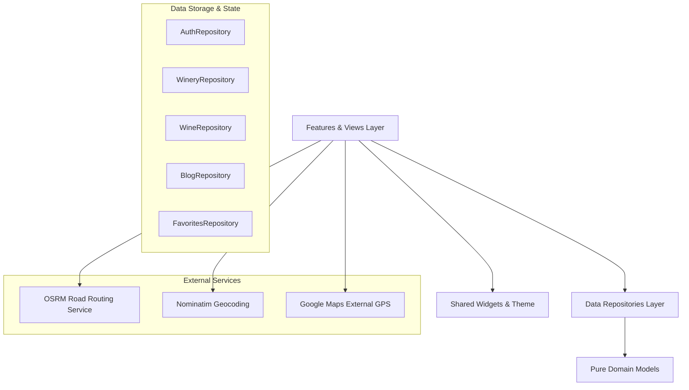

# 🍇 Winery Finder — Documentação Técnica e Código Fonte


O **Winery Finder** é um aplicativo mobile e web desenvolvido em Flutter que conecta apreciadores de vinho a vinícolas do Brasil e do mundo. O sistema oferece mapa interativo livre, geocodificação automática do endereço do usuário, cálculo de trajeto real por ruas e rodovias com resposta em 0ms, navegação GPS no Google Maps, catálogo de vendas de vinhos, diretório de sommeliers profissionais, blog coletivo de harmonizações, guia de ajuda integrado e controle de permissões por perfil.

---

## 📋 Sumário
1. [Visão Geral e Arquitetura de Software](#-visão-geral-e-arquitetura-de-software)
2. [Estrutura Detalhada do Código Fonte](#-estrutura-detalhada-do-código-fonte)
3. [Perfis de Usuário e Regras de Negócio](#-perfis-de-usuário-e-regras-de-negócio)
4. [Módulos e Fluxos do Sistema](#-módulos-e-fluxos-do-sistema)
5. [Algoritmos e Serviços Integrados (Geocoding, OSRM & GPS)](#-algoritmos-e-serviços-integrados)
6. [Modelagem de Dados (Domain Layer)](#-modelagem-de-dados-domain-layer)
7. [Qualidade, Lint e Testes Automatizados](#-qualidade-lint-e-testes-automatizados)
8. [Como Executar e Deploy no GitHub](#-como-executar-e-deploy-no-github)

---

## 🎯 Visão Geral e Arquitetura de Software

O aplicativo adota uma arquitetura em camadas clara e modular baseada nos princípios de separação de conceitos (*Separation of Concerns*):

- **Domain Layer (`lib/domain/`)**: Regras de negócio puras e modelos imutáveis (sem dependência direta de UI ou frameworks externos).
- **Data Layer (`lib/data/`)**: Repositórios reativos baseados no padrão `ChangeNotifier` para gestão em tempo real do estado de autenticação, vinícolas, vinhos, postagens de blog e favoritos independentes por usuário.
- **Features Layer (`lib/features/`)**: Telas e componentes organizados por funcionalidade (*auth, map, blog, admin, favorites*).
- **Widgets Layer (`lib/widgets/`)**: Componentes visuais compartilhados, como o logo vetorial de cacho de uvas roxas, o fundo decorativo de vinhedo e o guia de ajuda com tutorial.



---

## 📁 Estrutura Detalhada do Código Fonte

```
lib/
├── main.dart                      # Ponto de entrada do app com inicialização de bindings
├── app.dart                       # Configuração do MaterialApp, tema vinho (Burgundy #722F37) e observador de sessão
├── domain/                        # Modelos e regras puras de domínio
│   ├── user_account.dart          # Modelo de usuário com suporte aos papéis (Admirador, Sommelier, Vinícola, Admin)
│   ├── winery.dart                # Modelo da vinícola (coordenadas, fotos, uvas cultivadas, sommelier, criador)
│   ├── wine_product.dart          # Modelo do vinho à venda (preço, safra, uva, foto, link de pagamento)
│   ├── blog_post.dart             # Modelo de publicações e comentários do Blog Coletivo
│   └── winery_filter.dart         # Algoritmos puros de filtragem textual e cálculo de distância
├── data/                          # Repositórios reativos e gestão de estado
│   ├── auth_repository.dart       # Gestão de usuários, login, cadastro, bloqueio e redefinição de senha
│   ├── winery_repository.dart     # Catálogo completo e global de vinícolas do Brasil e do mundo
│   ├── wine_repository.dart       # Gestão de produtos, alteração de preços e inativação
│   ├── blog_repository.dart       # Repositório de postagens e comentários do Blog Coletivo
│   └── favorites_repository.dart  # Gestão independente da lista de vinícolas salvas nos favoritos por usuário
├── features/                      # Telas e fluxos de interface do usuário
│   ├── auth/                      # Login (LoginScreen) e Cadastro com seleção de Perfil (RegisterScreen)
│   ├── admin/                     # Painel do Administrador (AdminDashboardScreen) e Diálogo de Edição (EditUserDialog)
│   ├── blog/                      # Blog Coletivo (BlogScreen) e Diretório de Sommeliers (SommeliersScreen)
│   ├── map/                       # Mapa com trajeto pelas ruas (MapScreen), Cadastro, Edição e Painel de Vendas
│   ├── favorites/                 # Tela de vinícolas salvas nos favoritos (FavoritesScreen)
│   └── home/                      # Casca de navegação inferior Material 3 (HomeShell)
└── widgets/                       # Componentes visuais estilizados
    ├── help_tutorial_dialog.dart  # Guia completo e tutorial passo a passo das telas na mesma tela
    ├── winery_logo.dart           # Logotipo vetorial em formato de cacho de uvas roxas brilhantes 3D
    └── vineyard_background.dart   # Fundo decorativo de videira com transparência em tom vinho
```

---

## 🔒 Perfis de Usuário e Regras de Negócio

| Perfil de Usuário | Permissões no Sistema |
| :--- | :--- |
| **🍷 Admirador de Vinhos** | Explora vinícolas no mapa, vê fotos, consulta trajeto pelas ruas do seu endereço, abre o Google Maps, compra vinhos via link direct, salva favoritos e comenta no Blog Coletivo. |
| **🎓 Sommelier Profissional** | Possui o cadastro de **Formação / Certificações** (ex: *WSET Level 3, ABS*) e **Histórico Profissional**, aparece no **Diretório de Sommeliers** e possui **permissão exclusiva para publicar matérias no Blog Coletivo**. |
| **🏢 Vinícola / Produtor** | Cadastra a vinícola (logo em 1º lugar, responsável em 2º lugar, sommelier, uvas e fotos), acessa o **Painel de Produtos** para cadastrar, editar preços, inativar ou excluir vinhos à venda, e consulta sommeliers e blog. |
| **🛡️ Administrador Master** | Acesso ao **Painel do Administrador (`admin@winery.com`)** com controle total para **editar cadastros, bloquear/desbloquear usuários, excluir contas** e moderar matérias e comentários do blog. |

---

## ⚙️ Algoritmos e Serviços Integrados

### 1. Geocodificação de Endereço (OpenStreetMap Nominatim)
Quando o usuário solicita o trajeto para uma vinícola, o método `_fetchRealRoadRoute` em `MapScreen` pega o endereço cadastrado no perfil do usuário (`currentUser.address`) e consulta a API pública Nominatim para obter a latitude e longitude exatas da partida:
`https://nominatim.openstreetmap.org/search?q={userAddress}&format=json&limit=1`

### 2. Trajeto Real pelas Ruas e Rodovias (OSRM Routing Machine com Resposta em 0ms)
O sistema calcula o vetor exato de coordenadas de cada curva de rua e avenida:
`https://router.project-osrm.org/route/v1/driving/{lon1},{lat1};{lon2},{lat2}?overview=full&geometries=geojson&steps=true`

- **Resposta Instantânea (0ms)**: Desenha o trajeto imediatamente na tela ao clicar, refinando as curvas detalhadas em segundo plano.
- **Visualização Destacada**: A rota é desenhada no mapa em camada dupla: uma borda externa em **amarelo/dourado neon (`AmberAccent`)** com espessura 11.0 e a linha interna principal na **cor vinho (`#722F37`)** com espessura 6.0.
- **Passo a Passo do Percurso**: Extrai os nomes das ruas, avenidas e rodovias (`steps`) exibindo a lista detalhada do itinerário na caixa abaixo do mapa.

### 3. Navegação GPS no Google Maps
Ao clicar no botão **"Seguir Rota com GPS"**, o aplicativo invoca o `url_launcher` e abre nativamente o Google Maps em modo de navegação curva a curva:
`https://www.google.com/maps/dir/?api=1&origin={userAddress}&destination={wineryLat},{wineryLon}&travelmode=driving`

---

## 📊 Modelagem de Dados (Domain Layer)

### Classe `UserAccount`
```dart
enum UserRole { admirer, sommelier, winery, admin }

class UserAccount {
  final String id;
  final String name;
  final String email;
  final String password;
  final UserRole role;
  final String photoUrl;
  final String cpf;
  final String phone;
  final String address;
  final bool isBlocked;
  final String professionalHistory;
  final String education;
  final String contactInfo;
}
```

### Classe `Winery`
```dart
class Winery {
  final String id;
  final String name;
  final String city;
  final Set<WineType> wineTypes;
  final double distanceKm;
  final double rating;
  final double latitude;
  final double longitude;
  final String address;
  final String logoUrl;
  final List<String> photoUrls;
  final String responsibleName;
  final String sommelierName;
  final List<String> cultivatedGrapes;
  final String creatorEmail;
}
```

### Classe `WineProduct`
```dart
class WineProduct {
  final String id;
  final String wineryId;
  final String name;
  final WineType type;
  final String vintage;
  final double price;
  final String grape;
  final String description;
  final String imageUrl;
  final String paymentLink;
  final bool isActive;
  final String creatorEmail;
}
```

---

## 🧪 Qualidade, Lint e Testes Automatizados

O projeto é mantido com rigoroso padrão de qualidade de código:
- **Testes de Unidade (`test/domain/winery_filter_test.dart`)**: Validação de buscas textuais insensíveis a acentos e maiúsculas/minúsculas, múltiplos filtros de vinho e cálculo de distância.
- **Testes de Interface (`test/features/home/home_shell_test.dart`)**: Validação de fluxo de sessão e navegação entre as 4 abas (*Mapa, Blog Coletivo, Sommeliers e Favoritos*).
- **Analisador Estático (`flutter analyze`)**: 0 erros e 0 avisos.

---

## 🚀 Como Executar e Deploy no GitHub

### Comandos de Desenvolvimento
```bash
# 1. Instalar dependências do pubspec.yaml
flutter pub get

# 2. Rodar a suíte de testes
flutter test

# 3. Executar o analisador de código
flutter analyze

# 4. Iniciar o aplicativo no Chrome ou Dispositivo
flutter run
```

### Repositório GitHub (`robsonsp29`)
- **Link Oficial**: [https://github.com/robsonsp29/winery](https://github.com/robsonsp29/winery)
- **Branch Principal**: `main`
